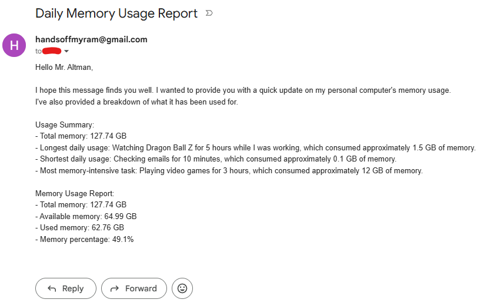

# Memory Usage Reporter for Ram Altman

This Python script reports the current system memory statistics and sends them in an email using the Gmail API. It reads the sender and optional recipient address from `.env`, authorizes through Google OAuth, and sends the message to Gmail's `users/me/messages/send` endpoint. It does not use SMTP or a Gmail app password.

## Example Output



## Requirements

- Python 3.10 or later
- A Google account with Gmail
- A Google Cloud project with the Gmail API enabled
- A Desktop app OAuth client json downloaded from Google Cloud

## Setup

### 1. Create Google OAuth credentials

1. Open the [Google Cloud Console](https://console.cloud.google.com/) and select or create a project.
2. Enable the **Gmail API** for that project.
3. Configure the OAuth consent screen. If the app is in **Testing** mode, add the Gmail account you will authorize as a test user.
4. Create an OAuth client ID with application type **Desktop app**.
5. Download the client JSON and save it in this project folder as `credentials.json`.

The script requests only the `https://www.googleapis.com/auth/gmail.send` scope. On first run, it opens a browser so you can authorize access. It saves the resulting OAuth token as `token.json` and refreshes it when possible.

### 2. Configure email addresses

Create a `.env` file in the project folder:

```dotenv
EMAIL_USER=your-account@gmail.com
EMAIL_RECIPIENT=recipient@example.com
```

`EMAIL_USER` must be the same Gmail account you authorize in the browser. `EMAIL_RECIPIENT` is optional; when omitted, the report is sent to `EMAIL_USER` itself.

### 3. Install dependencies

From the project folder, install the packages listed in `requirements.txt`:

```powershell
py -m pip install -r requirements.txt
```

If the `py` launcher is unavailable, use your Python executable in place of `py`.

### 4. Run the report

```powershell
py get_memory.py
```

The script prints the report to the console and, after successful sending, prints the Gmail message ID. The first run may require browser authorization; subsequent runs reuse `token.json`.

## What the script reports

The live values come from `psutil.virtual_memory()`:

- Total system memory
- Available memory (labeled “Idle memory” in the email)
- Used memory
- Memory utilization percentage

The email also includes example usage-summary entries written into the script. Those entries are static text and are not calculated or monitored by the program.

## Troubleshooting

- **Gmail API returns 403:** Read the API's error reason in the exception. Confirm the Gmail API is enabled in the same Google Cloud project as `credentials.json`. If the error indicates insufficient scope, delete `token.json` and rerun so you can grant the requested permission again.
- **OAuth consent or test-user error:** Add the account you are authorizing to the OAuth consent screen's test users, if the app remains in Testing mode.
- **Wrong sender account:** Delete `token.json`, rerun, and authorize the intended Gmail account. Ensure it matches `EMAIL_USER`.
- **Missing OAuth client file:** Ensure the downloaded Desktop app JSON is named `credentials.json` and placed beside `get_memory.py`.

## Security notes

Do not commit `.env`, `credentials.json`, or `token.json`. The included `.gitignore` excludes these files. Treat the OAuth client file and token as credentials, and do not share them publicly.

## License and intent

See [LICENSE](LICENSE) for the full terms.

## Source of Inspiration


